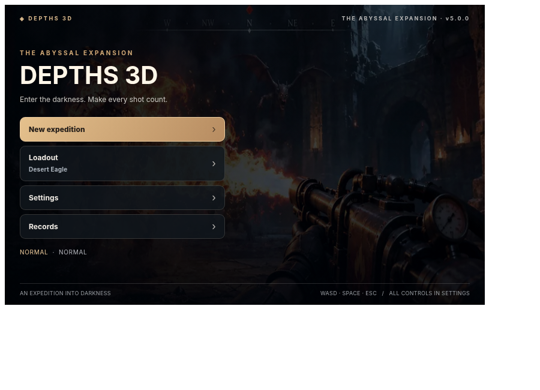

<div align="center">

# 🏰 Depths 3D

### The Abyssal Expansion · v5.0.0

*A first-person dark-fantasy dungeon shooter built with Three.js.*

[](CHANGELOG.md)
[](LICENSE)
[](https://richwokello.github.io/depths-3d/)
[](https://colab.research.google.com/github/RichWOkello/depths-3d/blob/main/depths_3d.ipynb)

**[Play in browser](https://richwokello.github.io/depths-3d/) · [Launch in Colab](https://colab.research.google.com/github/RichWOkello/depths-3d/blob/main/depths_3d.ipynb) · [Release notes](RELEASE_NOTES.md)**



<sub>Menu UI preview captured during browser UI testing; in-game 3D graphics may differ.</sub>

</div>

## Enter the Abyss

Descend through procedurally generated Gothic cathedrals, crypts and forgotten sanctuaries. Fight increasingly dangerous creatures, upgrade your weapons, discover secrets and survive cinematic boss encounters.

**Version 5.0.0** brings together the major combat, graphics, dungeon, AI, animation and menu improvements. The release keeps **eight playable weapon slots**, the existing campaign systems and a single source that builds for desktop browsers, GitHub Pages and Google Colab.

## Play

| Platform | How to start |
| --- | --- |
| **GitHub Pages** | **[Play here](https://richwokello.github.io/depths-3d/)**. This link will show v5.0.0 **after** the updated files are pushed to `main` and Pages finishes deploying. |
| **Google Colab** | **[Open notebook](https://colab.research.google.com/github/RichWOkello/depths-3d/blob/main/depths_3d.ipynb)**. Run the game cell, then interact with the game iframe. |
| **Standalone HTML** | Download this repository and open `PLAY_DIRECTLY.html` in Chrome or Edge. |
| **Local server** | In the repository folder, run `python -m http.server 8000`, then visit `http://localhost:8000/`. |

You need a WebGL-capable browser and an internet connection to load the pinned **Three.js r128** library. The game does not require a separate game engine installation. Music and sound start following a user interaction due to browser autoplay rules.

## Features

- **Eight weapons:** Desert Eagle, Remington 870, UMP9, AK-86, M79 grenade launcher, M2-style flamethrower, katana and Light Saber.
- **Action combat:** projectiles, recoil, reloads, stamina-based melee, timed parry, slash trails, weak points and environmental effects.
- **Dungeon exploration:** rotating Gothic environments, secret passages, environmental hazards, ritual switches, crypt keys, treasure and discoverable objectives.
- **Enemies and bosses:** different monster behaviors, maze-aware navigation, telegraphed boss attacks and four named boss encounters.
- **Progression:** upgrades, pickups, inventory, Soul Forge, checkpoints, 20-floor campaign, Survival and New Game+.
- **Cinematic presentation:** animated intro, atmospheric artwork/audio, compact HUD, first-person hand/weapon models and uncluttered settings-driven menus.

These are **procedural 3D graphics and synthesized sound**, not photogrammetry or professional motion capture. See [feature coverage](FEATURE_MATRIX.md) and the [testing report](TEST_REPORT.md) for what is implemented and verified.

## Controls

| Input | Action | Input | Action |
| --- | --- | --- | --- |
| `W A S D` | Move | `Shift` | Sprint |
| Mouse / `Q E` / arrows | Aim or turn | `1`–`8` / wheel | Switch weapons |
| Left-click / `Space` / `F` | Fire or slash | `R` | Reload firearm |
| `G` | Heavy melee strike | `T` | Melee thrust |
| Hold `C` | Guard / timed parry | `V` | Charged saber wave |
| `B` | AK fire mode | `Tab` | Weapon selection |
| `I` | Inventory | `H` | Medkit |
| `X` | Activate rune switch | `P` / `Esc` | Pause / resume |

For other settings and controls, open **Settings → Controls** in the game.

## Project layout

```text
depths-3d/
├── .github/workflows/verify.yml   # lightweight build checks
├── .gitignore
├── .gitattributes
├── .nojekyll
├── src/
│   ├── game.js                     # single game source of truth
│   ├── game.html                   # game root / interface markup
│   ├── intro_art.webp
│   └── menu_art.webp
├── docs/menu-preview.png          # menu UI preview
├── tests/                        # offline / browser regression scripts
├── index.html                    # GitHub Pages entry point
├── PLAY_DIRECTLY.html            # single-file desktop browser build
├── depths_3d.ipynb               # self-contained Colab notebook
├── colab_one_cell.py             # paste-in-Colab alternative
├── build.py                      # regenerates the four distributions
├── README.md
├── CHANGELOG.md
├── RELEASE_NOTES.md
├── UPDATE_LOCAL_REPO.md
├── FEATURE_MATRIX.md
├── TEST_REPORT.md
└── LICENSE
```

### Editing the game

Edit `src/game.js` and/or `src/game.html`. Then regenerate all platform entry points from the **same source**:

```bash
python build.py
node --check src/game.js
```

Commit all regenerated outputs (`index.html`, `PLAY_DIRECTLY.html`, `depths_3d.ipynb` and `colab_one_cell.py`) with the source. The included GitHub Actions workflow checks JavaScript syntax, notebook JSON, and whether generated outputs are in sync. It **does not** certify GPU rendering or sound quality.

## Updating the existing GitHub repository

Follow **[UPDATE_LOCAL_REPO.md](UPDATE_LOCAL_REPO.md)** to copy the v5.0.0 files over an existing local clone of `RichWOkello/depths-3d`, review the changes and push to `main`. GitHub Pages is already configured in the existing repository, so no new repository is required.

## Testing and limitations

Gameplay/menu and combat tests were run in headless Chromium with a **simulated Three.js renderer**. Live WebGL visuals, Colab GPU/browser behavior, long-session frame rate, and real browser persistence still require hands-on verification. The implementation is not a photorealistic AAA game; not every feature in the original expansion brief is complete.

- [Test report](TEST_REPORT.md)
- [Feature matrix](FEATURE_MATRIX.md)
- [Changelog](CHANGELOG.md)
- [Release notes](RELEASE_NOTES.md)

---

Developed by **Richard Okello** · [@RichWOkello](https://github.com/RichWOkello) · Licensed under [MIT](LICENSE).
